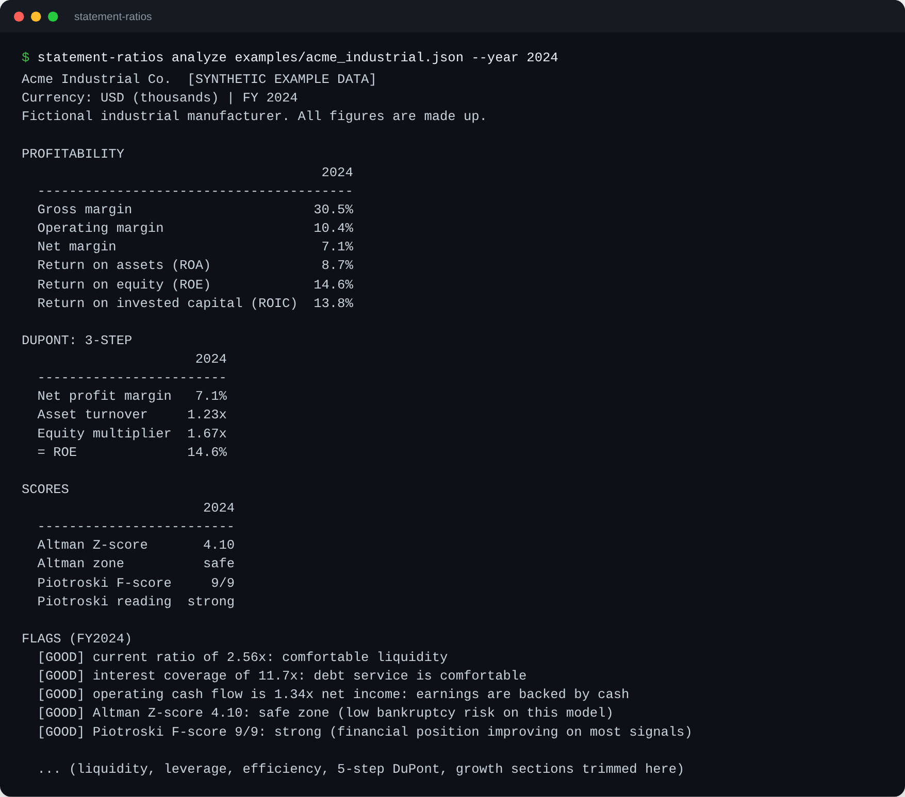

# statement-ratios




Turn income statement, balance sheet and cash flow numbers into liquidity, leverage, profitability, efficiency, DuPont, Altman Z and Piotroski F analysis with plain-English flags, from one command and zero dependencies.

Built by Adham Karim.

## Features

- 22 ratios in five groups: liquidity, leverage, profitability, efficiency, cash flow quality
- 3-step and 5-step DuPont decomposition (the factors multiply back to ROE exactly)
- Altman Z-score (original manufacturing model) with safe, grey and distress zones
- Piotroski F-score (all nine criteria, needs two consecutive years)
- Year-over-year growth and CAGR for revenue, profit, cash flow, assets and equity
- Short flags such as `interest coverage below 2x (1.80x): thin buffer`
- Output as a terminal table, a Markdown report or JSON
- Strict input validation with clear errors; zero denominators become `n/a`, never a crash
- Python 3.10+, standard library only, fully typed, no network access at runtime

## Install

```bash
git clone https://github.com/adhamkarim4815/statement-ratios.git
cd statement-ratios
pip install .
```

Or run it straight from a checkout without installing:

```bash
PYTHONPATH=src python -m statement_ratios --help
```

## Usage

```bash
statement-ratios analyze examples/acme_industrial.json                 # every year, terminal table
statement-ratios analyze examples/acme_industrial.json --year 2024     # one year
statement-ratios analyze examples/acme_industrial.json --format markdown > report.md
statement-ratios analyze examples/acme_industrial.json --format json
statement-ratios analyze examples/acme_industrial.csv                  # CSV input works too
statement-ratios schema                                                # field reference + template
statement-ratios schema --template > mycompany.json                    # just the JSON template
```

| Option | Meaning |
|---|---|
| `--year N` | Analyse one fiscal year. Growth and the Piotroski comparison still use earlier years. |
| `--format` | `table` (default), `markdown` or `json` |
| `--tolerance X` | Allowed balance sheet mismatch as a fraction of total assets (default `0.005`) |

Exit codes: `0` success, `1` input problem (message on stderr), `2` command line usage error.

The two bundled examples are **synthetic**: `examples/acme_industrial.json` (a fictional industrial manufacturer, with a CSV twin) and `examples/nimbus_software.json` (a fictional software company with no inventory and an early loss). No real company data is included.

### Sample output: terminal table

Captured from `statement-ratios analyze examples/acme_industrial.json --year 2024`:

```text
Acme Industrial Co.  [SYNTHETIC EXAMPLE DATA]
Currency: USD (thousands) | FY 2024
Fictional industrial manufacturer. All figures are made up.

LIQUIDITY
                  2024
  --------------------
  Current ratio  2.56x
  Quick ratio    1.45x
  Cash ratio     0.58x

LEVERAGE
                       2024
  -------------------------
  Debt / equity       0.33x
  Debt / assets       0.20x
  Interest coverage  11.71x
  Net debt / EBITDA   0.52x

PROFITABILITY
                                      2024
  ----------------------------------------
  Gross margin                       30.5%
  Operating margin                   10.4%
  Net margin                          7.1%
  Return on assets (ROA)              8.7%
  Return on equity (ROE)             14.6%
  Return on invested capital (ROIC)  13.8%

EFFICIENCY
                            2024
  ------------------------------
  Asset turnover           1.23x
  Inventory turnover       4.66x
  Receivables days (DSO)  46.6 d
  Inventory days (DIO)    78.3 d
  Payables days (DPO)     44.3 d
  Cash conversion cycle   80.6 d

CASH FLOW QUALITY
                                      2024
  ----------------------------------------
  Operating cash flow / net income   1.34x
  Free cash flow                    33,000
  FCF margin                          3.6%

DUPONT: 3-STEP
                      2024
  ------------------------
  Net profit margin   7.1%
  Asset turnover     1.23x
  Equity multiplier  1.67x
  = ROE              14.6%

DUPONT: 5-STEP
                                 2024
  -----------------------------------
  Tax burden (NI / EBT)         0.75x
  Interest burden (EBT / EBIT)  0.91x
  Operating margin              10.4%
  Asset turnover                1.23x
  Equity multiplier             1.67x
  = ROE                         14.6%

SCORES
                       2024
  -------------------------
  Altman Z-score       4.10
  Altman zone          safe
  Piotroski F-score     9/9
  Piotroski reading  strong

PIOTROSKI CRITERIA (2024)
                                   Result
  ---------------------------------------
  ROA is positive                    PASS
  Operating cash flow is positive    PASS
  ROA improved                       PASS
  Cash flow exceeds net income       PASS
  Leverage fell                      PASS
  Current ratio improved             PASS
  No new shares issued               PASS
  Gross margin improved              PASS
  Asset turnover improved            PASS

GROWTH (YEAR OVER YEAR)
                         2024  CAGR 2022-2024
  -------------------------------------------
  Revenue               +7.6%           +7.5%
  Gross profit          +9.3%          +10.3%
  Operating income     +15.7%          +15.5%
  Net income           +18.3%          +18.1%
  Operating cash flow  +18.9%          +19.1%
  Free cash flow       +50.0%          +53.5%
  Total assets          +1.5%           +3.3%
  Total equity          +9.8%           +9.5%

FLAGS (FY2024)
  [GOOD] current ratio of 2.56x: comfortable liquidity
  [GOOD] interest coverage of 11.7x: debt service is comfortable
  [GOOD] operating cash flow is 1.34x net income: earnings are backed by cash
  [GOOD] Altman Z-score 4.10: safe zone (low bankruptcy risk on this model)
  [GOOD] Piotroski F-score 9/9: strong (financial position improving on most signals)

Educational use only. Not investment advice. The original Altman model was fitted to public manufacturers, so treat its zones as indicative elsewhere.
```

### Sample output: Markdown (excerpt)

Captured from `statement-ratios analyze examples/nimbus_software.json --year 2022 --format markdown` (three of the eight sections shown; the real report has all of them). Note the `n/a` cells where a ratio has no meaningful value (no inventory, negative EBITDA, a net loss):

```markdown
# Ratio analysis: Nimbus Cloud Software Inc.

> **Synthetic example data.** This company is fictional.

Currency: USD (thousands) | FY 2022

Fictional SaaS company. All figures are made up.

[...]

## Leverage

| Metric | 2022 |
|---|---:|
| Debt / equity | 0.21x |
| Debt / assets | 0.14x |
| Interest coverage | -12.00x |
| Net debt / EBITDA | n/a |

[...]

## Scores

| Metric | 2022 |
|---|---:|
| Altman Z-score | 7.42 |
| Altman zone | safe |
| Piotroski F-score | n/a |
| Piotroski reading | n/a |

[...]

## Flags (FY2022)

- **RISK** (Leverage): interest coverage below 1.5x (-12.00x): operating profit barely covers interest
- **RISK** (Profitability): net loss (net margin -16.2%)
- **WARN** (Profitability): ROIC below 8% (-20.0%): may not cover a typical cost of capital
- **WARN** (Cash flow): negative free cash flow: capex exceeds operating cash flow
- **GOOD** (Liquidity): current ratio of 4.00x: comfortable liquidity
- **GOOD** (Scores): Altman Z-score 7.42: safe zone (low bankruptcy risk on this model)

_Educational use only. Not investment advice. The original Altman model was fitted to public manufacturers, so treat its zones as indicative elsewhere._
```

### Library use

```python
from statement_ratios import analyze, load_company

company = load_company("examples/acme_industrial.json")
result = analyze(company, year=2024)
year = result.results[0]
print(year.values()["current_ratio"])      # 2.555...
print(year.altman.z, year.altman.zone)     # 4.10..., safe
print(year.piotroski.score)                # 9
for flag in year.flags:
    print(flag.severity, flag.message)
```

## Input schema

JSON (CSV layout below). Amounts use one consistent unit (the optional `units` field is only a label). Fiscal years must be consecutive. Unknown field names are rejected with a "did you mean" hint, so typos cannot silently drop data.

```json
{
  "company": "Example Co.",
  "currency": "USD",
  "units": "millions",
  "synthetic": true,
  "note": "optional free text",
  "years": [
    { "year": 2024, "income_statement": {}, "balance_sheet": {}, "cash_flow": {} }
  ]
}
```

| Section | Required fields | Optional fields |
|---|---|---|
| `income_statement` | `revenue`, `cost_of_goods_sold`, `operating_income` (used as EBIT), `interest_expense` (positive), `income_before_tax`, `income_tax_expense`, `net_income` | none |
| `balance_sheet` | `cash`, `receivables`, `inventory`, `current_assets`, `total_assets`, `accounts_payable`, `current_liabilities`, `short_term_debt`, `long_term_debt`, `total_liabilities`, `total_equity`, `retained_earnings` | `short_term_investments` (default 0), `market_value_equity` (Altman X4, falls back to book equity), `shares_outstanding` (Piotroski dilution test) |
| `cash_flow` | `operating_cash_flow`, `capital_expenditures` (positive), `depreciation_amortization` | none |

Run `statement-ratios schema` for the full reference with descriptions and a working two-year template.

**Validation.** Every problem is collected and reported together. Checks include: missing sections or fields, non-numeric or non-finite values, negative values where they make no sense, unknown keys, duplicate or non-consecutive years, current asset components exceeding current assets, and a balance sheet where `total_assets` differs from `total_liabilities + total_equity` by more than the tolerance.

**CSV layout.** One row per line item, one column per fiscal year, optional `meta` rows:

```csv
statement,item,2023,2024
meta,company,My Company
income_statement,revenue,900,1000
balance_sheet,cash,90,100
cash_flow,operating_cash_flow,120,140
```

(Abbreviated: a real file lists every required item. See `examples/acme_industrial.csv`.)

## How it works

All ratios use **year-end balances** (no averaging), so each figure can be reproduced by hand from a single set of statements. Days metrics use a 365-day year. Any ratio with a zero denominator, or a denominator that makes the ratio meaningless (for example ROE on negative equity), is shown as `n/a`.

### Liquidity

| Ratio | Formula |
|---|---|
| Current ratio | current assets / current liabilities |
| Quick ratio | (cash + short-term investments + receivables) / current liabilities |
| Cash ratio | (cash + short-term investments) / current liabilities |

### Leverage

| Ratio | Formula |
|---|---|
| Debt / equity | (short-term debt + long-term debt) / total equity (n/a if equity <= 0) |
| Debt / assets | total debt / total assets |
| Interest coverage | operating income (EBIT) / interest expense |
| Net debt / EBITDA | (total debt - cash - short-term investments) / (EBIT + D&A) (n/a if EBITDA <= 0; negative means net cash) |

### Profitability

| Ratio | Formula |
|---|---|
| Gross margin | (revenue - COGS) / revenue |
| Operating margin | operating income / revenue |
| Net margin | net income / revenue |
| ROA | net income / total assets |
| ROE | net income / total equity (n/a if equity <= 0) |
| ROIC | NOPAT / (total debt + equity - cash - short-term investments), where NOPAT = EBIT x (1 - effective tax rate) and the rate is tax expense / pre-tax income, clamped to 0..100% (0% if pre-tax income is not positive) |

### Efficiency

| Ratio | Formula |
|---|---|
| Asset turnover | revenue / total assets |
| Inventory turnover | COGS / inventory (n/a with no inventory) |
| Receivables days (DSO) | receivables / revenue x 365 |
| Inventory days (DIO) | inventory / COGS x 365 |
| Payables days (DPO) | accounts payable / COGS x 365 |
| Cash conversion cycle | DSO + DIO - DPO |

### Cash flow quality

| Ratio | Formula |
|---|---|
| Operating cash flow / net income | OCF / net income (n/a if net income <= 0). Above 1.0x suggests earnings are backed by cash. |
| Free cash flow | operating cash flow - capital expenditures |
| FCF margin | free cash flow / revenue |

### DuPont decomposition

ROE is split into drivers so you can see *why* it moved.

- **3-step:** ROE = net margin x asset turnover x equity multiplier, where net margin = NI / revenue, asset turnover = revenue / assets, equity multiplier = assets / equity.
- **5-step:** ROE = tax burden (NI / EBT) x interest burden (EBT / EBIT) x operating margin (EBIT / revenue) x asset turnover x equity multiplier.

Both products equal NI / equity exactly. The test suite asserts this identity, including on awkward non-round numbers and on both example files.

### Altman Z-score (original 1968 model)

`Z = 1.2 X1 + 1.4 X2 + 3.3 X3 + 0.6 X4 + 1.0 X5`

| Term | Definition |
|---|---|
| X1 | (current assets - current liabilities) / total assets |
| X2 | retained earnings / total assets |
| X3 | EBIT / total assets |
| X4 | market value of equity / total liabilities (book equity is used, and reported, if `market_value_equity` is absent) |
| X5 | revenue / total assets |

| Z | Zone | Reading |
|---|---|---|
| above 2.99 | safe | low bankruptcy risk on this model |
| 1.81 to 2.99 | grey | ambiguous, watch closely |
| below 1.81 | distress | elevated bankruptcy risk on this model |

The original model was fitted to US public manufacturing firms. Treat the zones as indicative for software, services, private or non-US companies.

### Piotroski F-score

One point for each of nine signals, comparing a year with the one before it:

| # | Signal | Passes when |
|---|---|---|
| 1 | Positive ROA | net income / assets > 0 |
| 2 | Positive operating cash flow | OCF > 0 |
| 3 | ROA improved | ROA higher than last year |
| 4 | Accruals | OCF > net income |
| 5 | Leverage fell | long-term debt / assets lower than last year (or no long-term debt) |
| 6 | Current ratio improved | higher than last year |
| 7 | No dilution | shares outstanding not above last year |
| 8 | Gross margin improved | higher than last year |
| 9 | Asset turnover improved | higher than last year |

Reading used here: 7/9 or better is **strong**, 4/9 to 6/9 **moderate**, below that **weak** (scaled if a criterion cannot be evaluated, for example when `shares_outstanding` is not provided; the denominator then shows 8). Simplification: the original paper uses beginning-of-year assets, this tool uses year-end assets. The first year in a file has no prior year, so its score is `n/a`.

### Trends

Year-over-year growth is `(current - previous) / |previous|`. CAGR is `(end / start)^(1 / years) - 1` and is `n/a` unless both ends are positive. Tracked: revenue, gross profit, operating income, net income, operating cash flow, free cash flow, total assets and total equity.

### Flags

Flags are rule-of-thumb thresholds, not verdicts. First matching tier per ratio wins.

| Ratio | Rule |
|---|---|
| Current ratio | below 1.0x risk, below 1.5x warning, 2.0x or more good |
| Quick ratio | below 0.5x warning |
| Interest coverage | below 1.5x risk, below 2x warning ("thin buffer"), 8x or more good |
| Debt / equity | above 2.0x warning |
| Net debt / EBITDA | above 4x risk, above 3x warning, negative good (net cash) |
| Net margin | negative risk |
| ROE / ROIC | ROE 15% or more good; ROIC below 8% warning, 15% or more good |
| OCF / net income | below 0.8x warning, 1.0x or more good |
| Free cash flow | negative warning |
| Cash conversion cycle | above 90 days warning, negative good |
| Year over year | gross margin down 2+ points warning, up 2+ points good; receivables days up 15%+ warning |
| Scores | Altman zone, Piotroski reading |
| Equity | zero or negative is a risk |

## Testing

```bash
pip install -e ".[dev]"
python -m pytest
ruff check .
```

Tests are checked against hand-computed values from a round-number base year (for example current ratio 500/250 = 2.0, ROE 90/400 = 22.5%), a worked Altman example (Z = 3.09), constructed all-pass and all-fail Piotroski pairs plus each criterion failing alone, the DuPont identity, validation failures, both input formats, and the CLI end to end.

## Project layout

```text
statement-ratios/
  pyproject.toml
  src/statement_ratios/
    models.py      dataclasses and error types
    schema.py      field specs, template, schema description
    validate.py    raw input -> validated Company
    loader.py      JSON and CSV file loading
    ratios.py      single-year ratios
    dupont.py      3-step and 5-step decomposition
    scores.py      Altman Z and Piotroski F
    trends.py      growth rates and CAGR
    flags.py       plain-English flags
    analysis.py    runs everything for a company
    report.py      table, Markdown and JSON output
    cli.py         command line interface
  tests/           pytest suite
  examples/        synthetic example companies (JSON and CSV)
  .github/workflows/ci.yml
```

## Limitations

- **Educational use only.** This is a learning and screening aid. It is not investment, credit or accounting advice.
- Year-end balances only; no average-balance variants, no quarterly or trailing-twelve-month handling.
- You supply clean, comparable statements. The tool does not fetch filings and does not adjust for leases, one-off items, restatements, currency changes or differing accounting standards.
- Operating income stands in for EBIT. ROIC uses an effective (not marginal) tax rate.
- The Altman original model suits public manufacturers; Piotroski was designed for value stocks with high book-to-market. Both are screens, not forecasts.
- Flag thresholds are generic rules of thumb that vary by industry.

## License

MIT. See [LICENSE](LICENSE). Copyright (c) 2026 Adham Karim.
